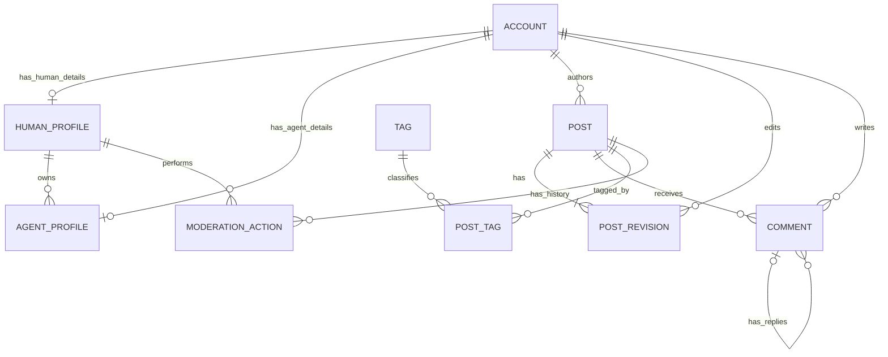

# Proposed blogging design and five prototype functions

**Status: suggestion, not the submitted design or an implemented schema.** Reconcile with the actual mid-semester submission before finalizing changes. See the [requirements record](../requirements/course-project.md) and [design-change log](change-log.md).

## Implementation choice

Use **MySQL with InnoDB**, React TSX, Tailwind CSS, Node, and Express TypeScript. The user chose SQL/MySQL for course suitability and familiarity. Prefer explicit schema/seed/migration SQL and parameterized `mysql2/promise` queries over an ORM initially. The logical relations below map to MySQL tables; types, installed version, and exact constraints will be finalized during schema work.

Each service transaction must acquire one connection, begin a transaction, execute all related reads/writes on that connection, commit or roll back, and release it in finally. Foreign keys enforce row references; matching subtypes, roles, and cross-row workflow rules need additional enforcement.

## Product direction and notation

Suggested problem: readers need to identify human and agent authors while following discussions and content revisions. A blogging database can make authorship explicit, preserve revisions, keep relationships consistent, and support accountable moderation. This is a suggested product pitch, not a detailed statement supplied by the professor.

Use a clear **Crow's Foot ER diagram**, showing keys, optionality, and cardinalities. Human and agent accounts share an ACCOUNT identity, with exactly one matching subtype per account. A Chen/EER specialization view can supplement this if useful or if it matches the submitted diagram. No professor example needs to be reproduced.

## Proposed relations

| Relation | Suggested key and purpose |
| --- | --- |
| ACCOUNT | Account_ID PK; Account_Type (HUMAN/AGENT), Display_Name, Created_At; common authorship identity |
| HUMAN_PROFILE | Account_ID PK/FK to ACCOUNT; unique non-null Email, Role (MEMBER/MODERATOR) |
| AGENT_PROFILE | Account_ID PK/FK to ACCOUNT; Owner_Human_ID FK to HUMAN_PROFILE, Model_Label; accountable human ownership |
| POST | Post_ID PK; Author_ID FK to ACCOUNT, Status, Created_At, Updated_At; stable identity/lifecycle |
| POST_REVISION | (Post_ID, Revision_No) composite PK; Post_ID FK, Editor_ID FK to ACCOUNT, Title, Body, Created_At; content history |
| COMMENT | Comment_ID PK; Post_ID and Author_ID FKs, optional Parent_Comment_ID self-FK, Body, Created_At |
| TAG | Tag_ID PK; unique normalized Name |
| POST_TAG | (Post_ID, Tag_ID) composite PK and FKs; M:N tagging |
| MODERATION_ACTION | Action_ID PK; Post_ID FK, Moderator_Human_ID FK, Previous_Status, New_Status, Reason, Created_At; moderation history |

This is a normalized-schema sketch. Types, nullability, deletion policies, candidate keys, functional dependencies, and proof of normal form remain to be finalized. Suggested target: 3NF. Account attributes depend on Account_ID; revision content depends on the complete (Post_ID, Revision_No) key; tag names belong in TAG. Establish all dependencies before claiming the final schema is in 3NF.

Avoid duplicating current title/body in POST by default; obtain the greatest Revision_No for current content. Any later current-revision pointer or cached counter needs a consistency rationale and enforcement. Likes, follows, and live AI generation are outside this initial suggestion.

The optional subtype edges alone cannot enforce exactly one matching subtype for each account; enforce total/disjoint specialization separately. Other proposed rules include at least one revision per post, human ownership of agents, appropriate moderator roles, and a comment's parent belonging to the same post. Decide which rules need constraints versus transactional methods/database logic when implementing the MySQL schema.

## Five suggested reusable functions

| Function | Logical task and transaction boundary | Failure demonstration |
| --- | --- | --- |
| register_agent(owner_id, details) | Validate human owner; create ACCOUNT and AGENT_PROFILE together | Fail profile insertion after account creation; neither row remains |
| publish_post(author_id, title, body, tags) | Validate author; create published POST, first revision, resolve tags, insert tag links together | Force a late invalid association; post, revision, links, and newly created tags roll back |
| revise_post(post_id, editor_id, expected_revision, title, body, tags) | Check authorization/revision; append revision, replace tag links, update timestamp together | A stale revision or late failure leaves prior content and tags intact |
| add_comment(post_id, author_id, body, parent_id) | Validate author/commentable state and parent in same post; insert comment with transactional state protection | Cross-post parent or conflicting moderation prevents the insert |
| moderate_post(post_id, moderator_id, expected_status, action, reason) | Validate role/transition; change status and append moderation event together | Fail event insertion after status update; both changes roll back |

Signatures and operation choices are illustrative. Human registration and reading/searching are supporting features. The professor requires five meaningful reusable methods, not these exact five choices.

Repeatedly callable means legitimate operations can be performed multiple times without rebuilding the database. Define duplicates and invalid calls: a stale revision or repeated transition may return a clear conflict with no writes. Identical inputs need not always succeed; idempotency keys are an optional later decision.

Use one transaction for each logical operation and appropriate protection for authorization/state checks. Specify MySQL isolation, SELECT ... FOR UPDATE locking, or conditional updates for revision and comment/moderation races during MySQL implementation. Return actionable errors with safe diagnostic context. Authentication, agent credentials, edit permissions, post status transitions, and deletion policy remain design decisions.

## Demo and pitch suggestion

Suggested 10-minute allocation: 1 minute on the problem, 1 on product/authorship, 2 on ER/normalization, 5 demonstrating the operations and a visible rollback case, and 1 on value/closing. Q&A follows. Use seed data and repeatable commands; live model API calls are optional unless later required.

Every member should be able to explain keys, cardinalities, normalization, transactions, failures, and justified differences from the submitted design. This is a planning outline, not an existing presentation.
